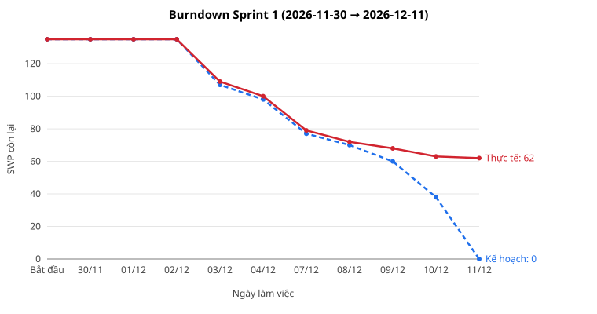

# Báo cáo tiến độ — Yuki Cold WMS, Sprint 1

- **Iteration trên GitHub Project:** `Sprint 1` — [Yuki Cold WMS — Backlog](https://github.com/users/trungbx-20131/projects/2), trường Iteration = Sprint 1
- **Khoảng thời gian giả lập:** 2026-11-30 → 2026-12-11 (10 ngày làm việc; Iteration trên Project kéo dài 14 ngày lịch, 2026-11-30 → 2026-12-13)
- Đây là sprint giả lập: trạng thái được cập nhật trên Project như sau một sprint chạy thật, rồi đọc lại từ Project để lập báo cáo này (đọc ngày 2026-10-13).
- **Thuật ngữ và mã:** SWP (Standard Work Point) là điểm khối lượng chuẩn của một việc, chấm theo độ rộng × độ khó; giờ ước lượng quy từ SWP (cách quy ở [estimate.md](estimate.md)). Mã `E-nn` là epic, `I-nnn` là issue, `I-nnn.m` là sub-issue; mã trong báo cáo dẫn tới issue trên GitHub. `Qn`, `KH-L4-nn` là mã câu hỏi gửi khách còn mở từ bộ thiết kế chi tiết (danh sách ở [task-breakdown.md](task-breakdown.md) mục 1.4 và [PREMISE.md](PREMISE.md)). BrSE: kỹ sư cầu nối giữa đội phát triển và khách Nhật. MFA: xác thực nhiều lớp. UAT: kiểm thử chấp nhận do khách thực hiện. Ràng buộc giờ lái 2024: giới hạn giờ làm việc của tài xế xe tải theo 改善基準告示 sửa đổi (chuẩn cải thiện điều kiện làm việc của tài xế, hiệu lực 4/2024).

## 1. Trạng thái

Việc lá có Iteration = Sprint 1 trên Project (issue và sub-issue không có việc con). SWP là điểm đã review, đọc từ trường SWP của Project.

| Trạng thái | Số issue | Tổng SWP | Ghi chú |
|---|---|---|---|
| Done | 17 | 73 | 17 việc, trong đó 3 issue làm rõ đã có đáp án |
| In Review | 5 | 29 | [#33](https://github.com/trungbx-20131/yuki-cold-wms-mng/issues/33) I-013, [#35](https://github.com/trungbx-20131/yuki-cold-wms-mng/issues/35) I-015, [#118](https://github.com/trungbx-20131/yuki-cold-wms-mng/issues/118) I-391, [#160](https://github.com/trungbx-20131/yuki-cold-wms-mng/issues/160) I-012.1, [#161](https://github.com/trungbx-20131/yuki-cold-wms-mng/issues/161) I-012.2 |
| In Progress | 4 | 15 | [#34](https://github.com/trungbx-20131/yuki-cold-wms-mng/issues/34) I-014, [#64](https://github.com/trungbx-20131/yuki-cold-wms-mng/issues/64) I-075, [#162](https://github.com/trungbx-20131/yuki-cold-wms-mng/issues/162) I-016.1, [#164](https://github.com/trungbx-20131/yuki-cold-wms-mng/issues/164) I-016.3 |
| Blocked | 3 | 10 | [#45](https://github.com/trungbx-20131/yuki-cold-wms-mng/issues/45) I-035, [#51](https://github.com/trungbx-20131/yuki-cold-wms-mng/issues/51) I-045, [#63](https://github.com/trungbx-20131/yuki-cold-wms-mng/issues/63) I-074 |
| Todo | 3 | 8 | [#39](https://github.com/trungbx-20131/yuki-cold-wms-mng/issues/39) I-019, [#53](https://github.com/trungbx-20131/yuki-cold-wms-mng/issues/53) I-051, [#163](https://github.com/trungbx-20131/yuki-cold-wms-mng/issues/163) I-016.2 |
| **Cộng** | **32** | **135** | |

Ngoài ra Iteration Sprint 1 có 4 issue cha (Iteration của issue cha là sprint mà việc con cuối cùng xong): [#30](https://github.com/trungbx-20131/yuki-cold-wms-mng/issues/30) I-010 (Done), [#31](https://github.com/trungbx-20131/yuki-cold-wms-mng/issues/31) I-011 (Done), [#32](https://github.com/trungbx-20131/yuki-cold-wms-mng/issues/32) I-012 (In Progress), [#36](https://github.com/trungbx-20131/yuki-cold-wms-mng/issues/36) I-016 (In Progress). Điểm của issue cha bằng tổng điểm việc con nên không cộng lại vào bảng trên.

Việc phát sinh trong sprint, chưa thành issue: Phép kiểm xe nạp hàng trùng xe của tuyến ở màn nạp xe, và phép kiểm ngược khi lập, sửa tuyến đã phát hành (từ I-391 [#118](https://github.com/trungbx-20131/yuki-cold-wms-mng/issues/118)) — chưa ước lượng, chưa thành issue; ước lượng và đưa vào kế hoạch ở buổi lập kế hoạch Sprint 2.

## 2. Burndown

| Ngày | Bắt đầu | 30/11 | 01/12 | 02/12 | 03/12 | 04/12 | 07/12 | 08/12 | 09/12 | 10/12 | 11/12 |
|---|---|---|---|---|---|---|---|---|---|---|---|
| Kế hoạch còn (SWP) | 135 | 135 | 135 | 135 | 107 | 98 | 77 | 70 | 60 | 38 | 0 |
| Thực tế còn (SWP) | 135 | 135 | 135 | 135 | 109 | 100 | 79 | 72 | 68 | 63 | 62 |

GitHub Insights không có lịch sử cho sprint giả lập, nên biểu đồ vẽ từ nhật ký trạng thái theo ngày: một việc được tính là xong từ ngày nó chuyển sang Done.

Lệch so với kế hoạch:

- **30/11–02/12 đúng kế hoạch; từ 03/12 chênh 2 SWP.** Câu hỏi Q5 về chính sách MFA và máy chủ định danh ([#51](https://github.com/trungbx-20131/yuki-cold-wms-mng/issues/51)) gửi khách ngày 03/12; tới cuối sprint khách chưa chọn nhà cung cấp định danh nên issue bị chặn.
- **09/12 chênh tăng lên 8 SWP.** Đăng nhập qua máy chủ định danh [#45](https://github.com/trungbx-20131/yuki-cold-wms-mng/issues/45) (6 SWP) đã dựng theo chuẩn OIDC chung, nhưng không kiểm được luật khoá tài khoản và nhóm vai bắt buộc MFA khi Q5 chưa có đáp án, nên bị chặn từ 09/12.
- **10/12 chênh tăng lên 25 SWP.** Migration sửa bảng prototype miền xuất kho [#160](https://github.com/trungbx-20131/yuki-cold-wms-mng/issues/160) chạy trên bản sao dữ liệu hiện có thì một phần bản ghi cũ không qua ràng buộc mới, vì schema prototype thiếu ràng buộc; phải thêm bước làm sạch dữ liệu trước khi áp ràng buộc. Các migration xếp sau trong cùng chuỗi bị kéo theo: I-012.2 [#161](https://github.com/trungbx-20131/yuki-cold-wms-mng/issues/161), I-013 [#33](https://github.com/trungbx-20131/yuki-cold-wms-mng/issues/33), I-015 [#35](https://github.com/trungbx-20131/yuki-cold-wms-mng/issues/35) đã viết xong, chờ chạy thử trọn chuỗi (In Review); I-014 [#34](https://github.com/trungbx-20131/yuki-cold-wms-mng/issues/34), I-016.1 [#162](https://github.com/trungbx-20131/yuki-cold-wms-mng/issues/162), I-016.3 [#164](https://github.com/trungbx-20131/yuki-cold-wms-mng/issues/164) còn dở (In Progress); I-016.2 [#163](https://github.com/trungbx-20131/yuki-cold-wms-mng/issues/163), I-051 [#53](https://github.com/trungbx-20131/yuki-cold-wms-mng/issues/53), I-019 [#39](https://github.com/trungbx-20131/yuki-cold-wms-mng/issues/39) chưa bắt đầu.
- **Các issue làm rõ chưa đóng như kế hoạch.** Khách đã trả lời câu hỏi KH-L4-32 về xe nạp hàng ([#118](https://github.com/trungbx-20131/yuki-cold-wms-mng/issues/118)), nhưng đáp án làm phát sinh việc mới (xem mục Rủi ro). Câu hỏi Q4 về file đơn ERP ([#63](https://github.com/trungbx-20131/yuki-cold-wms-mng/issues/63)) và câu hỏi về thông báo qua thư ([#64](https://github.com/trungbx-20131/yuki-cold-wms-mng/issues/64)) gửi ngày 11/12 nên chưa có đáp án. Kế hoạch đã giả định issue làm rõ đóng ngay trong ngày gửi câu hỏi; thực tế khách cần vài ngày.
- **Kết quả:** xong 73/135 SWP (54 %). 62 SWP (165,5 giờ) chuyển sang Sprint 2, trong đó 29 SWP đang ở In Review.

## 3. Rủi ro trễ

Mốc tham chiếu: hết Sprint 2 là 2026-12-25; hết giai đoạn xây dựng là 2027-04-02 (cuối Sprint 9); sau đó UAT 6 tuần, go-live 2027-06-01.

| Rủi ro | Issue | Ảnh hưởng tới mốc nào | Hành động | Ai làm, khi nào |
|---|---|---|---|---|
| Chuỗi migration nền chưa đóng (bản sao dữ liệu cũ vi phạm ràng buộc mới, phải thêm bước làm sạch). 9 việc ràng buộc giờ lái xe tải từ 2024 xếp ở Sprint 2 đều phụ thuộc chuỗi này, và chuỗi giờ lái nằm trên đường găng tới màn kiểm giới hạn giờ làm việc. | [#160](https://github.com/trungbx-20131/yuki-cold-wms-mng/issues/160) I-012.1, [#33](https://github.com/trungbx-20131/yuki-cold-wms-mng/issues/33) I-013, [#104](https://github.com/trungbx-20131/yuki-cold-wms-mng/issues/104) I-322, [#105](https://github.com/trungbx-20131/yuki-cold-wms-mng/issues/105) I-323, [#108](https://github.com/trungbx-20131/yuki-cold-wms-mng/issues/108) I-326, [#237](https://github.com/trungbx-20131/yuki-cold-wms-mng/issues/237) I-320.1, [#102](https://github.com/trungbx-20131/yuki-cold-wms-mng/issues/102) I-320 | Hết Sprint 2 (2026-12-25); API kiểm giới hạn giờ làm việc [I-320.1](https://github.com/trungbx-20131/yuki-cold-wms-mng/issues/237) (Sprint 3); màn kiểm giới hạn giờ làm việc [I-320](https://github.com/trungbx-20131/yuki-cold-wms-mng/issues/102) hoàn tất cùng bộ kiểm thử (Sprint 6); hết xây dựng 2027-04-02 | Đóng [I-012.1](https://github.com/trungbx-20131/yuki-cold-wms-mng/issues/160), [I-012.2](https://github.com/trungbx-20131/yuki-cold-wms-mng/issues/161), [I-013](https://github.com/trungbx-20131/yuki-cold-wms-mng/issues/33), [I-015](https://github.com/trungbx-20131/yuki-cold-wms-mng/issues/35) trong hai ngày đầu Sprint 2; ưu tiên backend cho chuỗi giờ lái trước các việc API khác của Sprint 2. Nếu tới 2026-12-16 chuỗi migration chưa đóng, dời các việc backend không nằm trên đường găng sang Sprint 8–9, nơi backend còn trống (Sprint 3 đã kín vì kỳ nghỉ đầu năm). | Trưởng nhóm backend — 2026-12-14 → 2026-12-16 |
| Khách chọn bắt buộc xe nạp hàng trùng xe của tuyến (câu hỏi KH-L4-32). Việc phát sinh (phép kiểm ở màn nạp xe, phép kiểm ngược khi lập và sửa tuyến đã phát hành) chưa có trong ước lượng, trong khi đệm cuối giai đoạn của frontend và kiểm thử gần như đã hết (phép kiểm ở màn nạp xe và lập tuyến cần cả frontend). | [#118](https://github.com/trungbx-20131/yuki-cold-wms-mng/issues/118) I-391, [#229](https://github.com/trungbx-20131/yuki-cold-wms-mng/issues/229) I-301.3, [#231](https://github.com/trungbx-20131/yuki-cold-wms-mng/issues/231) I-301.5, [#214](https://github.com/trungbx-20131/yuki-cold-wms-mng/issues/214) I-205.1, [#86](https://github.com/trungbx-20131/yuki-cold-wms-mng/issues/86) I-205 | Lập tuyến (Sprint 2, Sprint 4); nạp xe (Sprint 5, Sprint 8); hết xây dựng 2027-04-02 | Ước lượng việc phát sinh ở buổi lập kế hoạch Sprint 2 và trình khách dưới dạng yêu cầu thay đổi, kèm phương án đổi thứ tự ưu tiên để giữ mốc. Phần phát hành tuyến của [I-301.3](https://github.com/trungbx-20131/yuki-cold-wms-mng/issues/229) làm sau khi khách duyệt. | Quản lý dự án và trưởng nhóm backend; khách hàng duyệt — Ước lượng 2026-12-14; trình khách 2026-12-18 |
| Chưa có nhà cung cấp định danh và luật MFA, khoá tài khoản (câu hỏi Q5). Đăng nhập theo chuẩn OIDC chung đã dựng nhưng chưa kiểm được với máy chủ định danh thật. | [#51](https://github.com/trungbx-20131/yuki-cold-wms-mng/issues/51) I-045, [#45](https://github.com/trungbx-20131/yuki-cold-wms-mng/issues/45) I-035, [#314](https://github.com/trungbx-20131/yuki-cold-wms-mng/issues/314) I-531.1, [#150](https://github.com/trungbx-20131/yuki-cold-wms-mng/issues/150) I-530 | Quản lý người dùng và vai trò (Sprint 7, Sprint 8); kiểm thử hệ thống trước UAT | Đề nghị họp ngắn với bộ phận IT phía khách để chốt nhà cung cấp định danh. Trong lúc chờ, giữ cách dựng theo chuẩn OIDC chung (đổi nhà cung cấp chỉ đổi cấu hình); hạn chót nhận đáp án là trước Sprint 4. | BrSE; khách hàng (bộ phận IT) — Họp trước 2026-12-18; hạn chót 2027-01-08 |
| Đặc tả file đơn từ ERP và thông số SFTP chưa có (câu hỏi Q4); khách chờ bên cung cấp ERP xác nhận định dạng file. | [#63](https://github.com/trungbx-20131/yuki-cold-wms-mng/issues/63) I-074, [#59](https://github.com/trungbx-20131/yuki-cold-wms-mng/issues/59) I-070, [#60](https://github.com/trungbx-20131/yuki-cold-wms-mng/issues/60) I-071, [#65](https://github.com/trungbx-20131/yuki-cold-wms-mng/issues/65) I-076 | Nhận file đơn ERP (Sprint 4, job SFTP Sprint 6) | Đề nghị khách gửi một file mẫu thật đã ẩn dữ liệu cá nhân. Nếu tới 2027-01-08 chưa có, [I-070](https://github.com/trungbx-20131/yuki-cold-wms-mng/issues/59), [I-071](https://github.com/trungbx-20131/yuki-cold-wms-mng/issues/60) dựng theo mô tả cột hiện có và sửa lại khi có đặc tả. | BrSE; khách hàng (bên cung cấp ERP) — Nhắc 2026-12-14; hạn chót 2027-01-08 |
| Kế hoạch giả định issue làm rõ đóng ngay trong sprint gửi câu hỏi; thực tế khách cần vài ngày để trả lời. Còn 23 issue làm rõ ở Sprint 2–6. | [#64](https://github.com/trungbx-20131/yuki-cold-wms-mng/issues/64) I-075, [#63](https://github.com/trungbx-20131/yuki-cold-wms-mng/issues/63) I-074, [#51](https://github.com/trungbx-20131/yuki-cold-wms-mng/issues/51) I-045 | Các sprint có việc chờ đáp án của khách (Sprint 2–8) | Gửi câu hỏi sớm một sprint so với việc phụ thuộc; giữ một buổi hỏi đáp cố định mỗi tuần với khách; theo dõi tuổi câu hỏi chưa trả lời trong báo cáo tiến độ. | BrSE và quản lý dự án — Từ Sprint 2 (2026-12-14) |
| Sprint 1 còn 62 SWP (165,5 giờ) chuyển sang, trong đó 88,5 giờ backend và 64 giờ frontend, trong khi Sprint 2 chỉ còn trống khoảng 16,5 giờ backend và 8,5 giờ frontend. Vì vậy phải xếp lại cả kế hoạch, không chỉ Sprint 2. Xếp lại thử theo cùng luật phụ thuộc và năng lực: nếu việc đang review chỉ còn khoảng 25 % giờ và việc đang làm còn khoảng 50 %, việc cuối vẫn xong trong Sprint 9 nhưng 86 việc lá phải dời sang sprint sau, gồm 4 việc ràng buộc giờ lái; nếu các việc dở phải làm lại toàn bộ, 131 việc lá phải dời (7 việc giờ lái) và 4 việc (68 giờ) tràn sang Sprint 10, hết xây dựng trễ khoảng 3 ngày làm việc (khoảng 2027-04-07). Kế hoạch cũng chưa trừ kỳ nghỉ Tết Nguyên đán 2027 của đội phát triển (đầu tháng 2, rơi vào Sprint 5–6). | [#108](https://github.com/trungbx-20131/yuki-cold-wms-mng/issues/108) I-326, [#237](https://github.com/trungbx-20131/yuki-cold-wms-mng/issues/237) I-320.1, [#160](https://github.com/trungbx-20131/yuki-cold-wms-mng/issues/160) I-012.1 | Hết xây dựng 2027-04-02 (cuối Sprint 9); UAT 6 tuần trước go-live 2027-06-01 | Áp kế hoạch xếp lại ở buổi lập kế hoạch Sprint 2 và cập nhật Iteration trên GitHub Project; trừ năng lực của kỳ nghỉ Tết Nguyên đán khi xếp lại. Theo dõi burndown hằng ngày. Nếu sau Sprint 3 dự báo việc cuối vượt 2027-04-02, trình khách phương án giảm phạm vi đợt đầu hoặc điều chỉnh lịch UAT. | Quản lý dự án — Xếp lại 2026-12-14; xem lại khi hết Sprint 3 (2027-01-08) |
| Ước lượng có thể thấp ở ba epic: luật xuất kho và cấu hình luật (cặp [E-21](https://github.com/trungbx-20131/yuki-cold-wms-mng/issues/15) + [E-51](https://github.com/trungbx-20131/yuki-cold-wms-mng/issues/25), khoảng 361 giờ chênh với estimate LAB-1 không truy được về thay đổi phạm vi) và báo cáo ([E-44](https://github.com/trungbx-20131/yuki-cold-wms-mng/issues/24), khoảng 182 giờ). Cộng khoảng 543 giờ, tức khoảng 14 % tổng giờ ước lượng (lý do ở estimate.md mục so với LAB-1). | [#15](https://github.com/trungbx-20131/yuki-cold-wms-mng/issues/15) E-21, [#25](https://github.com/trungbx-20131/yuki-cold-wms-mng/issues/25) E-51, [#24](https://github.com/trungbx-20131/yuki-cold-wms-mng/issues/24) E-44 | Đơn xuất và phân bổ (Sprint 2–7); cấu hình luật (Sprint 3–8); báo cáo (Sprint 2–9); hết xây dựng 2027-04-02 | Ghi giờ thực tế cho mọi issue của ba epic và so với giờ ước lượng sau mỗi sprint. Nếu sau Sprint 3 giờ thực tế vượt ước lượng quá 20 %, ước lại phần còn lại của ba epic và trình khách cùng phương án phạm vi. | Trưởng nhóm backend và quản lý dự án — Từ Sprint 2 (2026-12-14); xem lại khi hết Sprint 3 (2027-01-08) |
